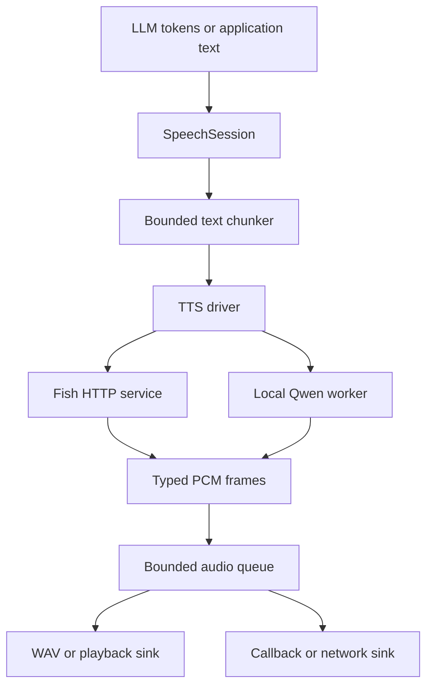

# Audri

**Streaming speech infrastructure for agents and applications.** Connect a
text response or an asynchronous token stream to Fish Speech or local Qwen3-TTS,
then send correctly framed audio to a WAV file, speaker, callback, or network
client. Each conversation has its own cancellation, bounded queues, and metrics.

The core uses the Python standard library. GPU frameworks, HTTP clients, API
servers, and playback libraries are loaded only when their backend is used.

Built with Fish Audio. The independently implemented Fish adapter targets the
native self-hosted service; model weights and inference source are not bundled.

## What is implemented

| Area | Behavior |
| --- | --- |
| Fish Speech | Native `/v1/tts` streaming, S2-Pro and Drama 3 server compatibility, inline or saved references, speaker IDs, style tags, sampling controls, health/defaults discovery |
| Qwen3-TTS | Lazy local model loading; VoiceDesign, CustomVoice, and single-reference Base cloning; serialized model access; native output sample rate |
| Streaming text | Latin and CJK boundaries, silence timeout, hard chunk bounds including final flush, preservation of model control tags |
| Audio | Immutable PCM16-LE frames carrying rate/channels; incremental WAV decoding; exact sample preservation and short final frames |
| Sessions | Bounded delta/text/audio queues; supervised failure propagation; ordered finalization; per-session barge-in and cleanup |
| Outputs | Atomic finalized WAV files, local `sounddevice` playback, callback, bounded iterator, and null sinks |
| Interfaces | Python API, command line, HTTP speech endpoint, and a WebSocket for streaming text plus binary audio |
| Operations | Input/output limits, deadlines, bounded admission, optional bearer auth, first-audio/RTF metrics, container CI |

This is a speech-generation framework. Speech recognition, echo cancellation,
WebRTC, codec transcoding, and model training are outside this implementation.

## Architecture



Fish performs native server-side incremental generation. The local Qwen Python
API returns a waveform for each committed text chunk, which Audri then frames.
Those two latency behaviors are deliberately distinguished. See
[architecture and invariants](docs/architecture.md).

## Quick start: client container

All Python execution stays in containers. The lightweight CPU client has its
own image; the existing Zephyr/Spack environment continues to own local Qwen
inference. No GPU is required on a Fish client machine.

```bash
docker build -f docker/Dockerfile.client --target runtime -t audri-client .
mkdir -p outputs

# Test the complete framing and WAV path with an explicitly diagnostic tone.
docker run --rm --user "$(id -u):$(id -g)" \
  -v "$PWD/outputs:/outputs" audri-client \
  speak 'Audio pipeline diagnostic.' --backend tone \
  --output /outputs/diagnostic.wav
```

This creates a real WAV test signal, **not synthesized speech**. Repeated writes
to an existing path require `--overwrite`.

For real speech, start the native Fish service using the pinned, container-only
[Fish setup guide](docs/fish-speech.md), then run on Linux:

```bash
docker run --rm --network host audri-client doctor --url http://127.0.0.1:8080

docker run --rm --network host --user "$(id -u):$(id -g)" \
  -v "$PWD/outputs:/outputs" audri-client \
  speak 'Hello. 你好，世界。' --backend fish \
  --url http://127.0.0.1:8080 --output /outputs/speech.wav
```

For a remote Fish server, use its reachable URL. `--network host` is a Linux
example; Docker Desktop users can use `host.docker.internal` for a host service.
Pass `-e FISH_API_KEY` when the upstream server requires a bearer token.

### Stream text as it arrives

`stream` reads incremental UTF-8 from stdin without waiting for complete lines:

```bash
printf 'Hello. This text can also come from an LLM token producer.\n' | \
  docker run --rm -i --network host --user "$(id -u):$(id -g)" \
  -v "$PWD/outputs:/outputs" audri-client \
  stream --backend fish --url http://127.0.0.1:8080 \
  --output /outputs/stream.wav
```

For long-form text already available as one complete script, `speak --stdin`
lets the model service manage the entire generation. Streaming text sessions
commit several independent requests. Request-level instructions and references
are applied to every chunk; inline speaker/style state is not automatically
carried from one request to the next. Send a complete multi-speaker script with
`speak` when it needs the model to retain context across that passage.

## Python API

Run examples inside the client container or the existing approved environment.
Replace the example `token_source` with any async iterator of model text.

```python
from audri import SpeakTool, SynthesisRequest
from audri.tts.fish import FishSpeechDriver
from audri.tts.audio_egress import WaveAudioEgress

driver = FishSpeechDriver("http://127.0.0.1:8080", max_concurrency=1)

async with SpeakTool(driver) as speech:
    await speech.start(
        "answer-1",
        request=SynthesisRequest("", reference_id="narrator"),
        egress=WaveAudioEgress("outputs/answer.wav"),
    )
    async for token in token_source:
        await speech.delta("answer-1", token)
    metrics = await speech.end("answer-1")
    print(metrics.as_dict())

    # While a session is active, another task can interrupt it:
    # await speech.stop("answer-1")
```

`narrator` must already exist on the native Fish server. Omitting the reference
lets the model choose a voice. For inline conditioning:

```python
from pathlib import Path
from audri import SynthesisRequest, VoiceReference

request = SynthesisRequest(
    text="A calm explanation, in the reference voice.",
    instruction="calm",
    references=(VoiceReference(
        audio=Path("reference.wav").read_bytes(),
        text="The exact transcript of the reference recording.",
    ),),
)
```

Direct driver use exposes the actual audio format and requires closing the
iterator when consumption ends early:

```python
from contextlib import aclosing

async with FishSpeechDriver("http://127.0.0.1:8080") as driver:
    async with aclosing(driver.stream(request)) as stream:
        async for frame in stream:
            print(frame.format.sample_rate, frame.samples, frame.duration_s)
            await consume_pcm(frame.pcm, frame.format)
```

The original `SpeakTool.start/delta/end/stop` methods remain available.
`driver.synth(...)` still yields bytes for legacy callers; new integrations
should use `stream(...)` so rate and channel metadata cannot be lost. Custom
drivers now implement `stream(SynthesisRequest, cancel=...)`; custom sinks
implement `write(AudioFrame)`, `close()`, and `abort()`.

The runnable [token stream example](examples/stream_tokens.py) is independent of
any LLM provider.

## HTTP and WebSocket API

Start the API against your Fish service:

```bash
docker run --rm --network host -e AUDRI_API_KEY -e FISH_API_KEY audri-client \
  serve --backend fish --url http://127.0.0.1:8080 \
  --host 127.0.0.1 --port 8765 --max-sessions 8
```

Set `AUDRI_API_KEY` for authenticated access. The CLI binds loopback by default;
the image's default command binds the container interface. Publish only the host
interface you intend to expose. `FISH_API_KEY` authenticates the separate model
service. Neither key belongs in a URL.

```bash
curl --fail-with-body http://127.0.0.1:8765/v1/audio/speech \
  -H 'Content-Type: application/json' \
  -H "Authorization: Bearer $AUDRI_API_KEY" \
  -d '{"input":"Hello from Audri.","response_format":"wav"}' \
  --output outputs/api.wav
```

| Interface | Contract |
| --- | --- |
| `GET /health` | Process health and admission counts; explicitly does not claim backend readiness |
| `POST /v1/audio/speech`, `wav` | Complete WAV with correct finite lengths, rendered to bounded temporary disk before response |
| `POST /v1/audio/speech`, `pcm` | Incremental raw PCM with `X-Audio-Sample-Rate`, channels, sample width, and encoding headers |
| `WS /v1/speech/stream` | Incremental text in, format metadata and binary PCM out, explicit stop and final metrics |

The HTTP input is `input` plus the fields of `SynthesisRequest` and
`response_format`. Unknown fields are rejected. This is an Audri API, not a
claim of complete OpenAI, hosted Fish, SGLang-Omni, or vLLM-Omni compatibility.

For WebSocket clients, send JSON messages in this order:

```json
{"type":"start","session_id":"turn-1","reference_id":"narrator"}
{"type":"delta","text":"Hello. "}
{"type":"delta","text":"How can I help?"}
{"type":"end"}
```

The server sends `started`, then `format`, binary PCM frames, and `ended` with
metrics. Send `{"type":"stop"}` during generation or draining for barge-in;
`stopped` acknowledges that the session has been torn down. No further PCM from
that session follows the acknowledgment. `ping` receives `pong`. Overflow
explicitly stops the session instead of silently dropping text. Authentication
uses the same Authorization header as HTTP; browser-native WebSocket clients
need an appropriate authenticated gateway because they cannot set arbitrary
headers themselves.

## Metrics and limits

Session metrics include accepted text characters, committed chunks, emitted
frames/audio duration, first generated audio latency, generator wait time,
queue high-water marks, elapsed time, and terminal state. Session RTF divides
generator wait time by emitted audio duration; the CLI benchmark measures total
client wall time divided by audio duration. Both include backend scheduling or
transport effects and are not pure GPU-kernel timings.

```bash
docker run --rm --network host audri-client \
  benchmark 'A representative sentence for your deployment.' \
  --backend fish --runs 10 --url http://127.0.0.1:8080
```

The first run can include warmup. Tone benchmark output is marked
`diagnostic_only`; it provides no model performance evidence.

Configure `SessionConfig` for queue sizes, delta/total text size, frame size,
total audio, and synthesis timeout. The service adds body limits, request and
send deadlines, WebSocket idle timeouts, and bounded admission. Slow consumers
exert backpressure; cancellation or a failed stage wakes blocked producers.

## Existing local Qwen workflow

The vendored Zephyr and MLSys kits and their pinned configs are unchanged.

```bash
just zephyr-check
just build-env
just smoke
just demo
```

`smoke` loads the real model and writes `outputs/smoke_test.wav`. The headless
demo writes one finalized `outputs/speak_demo.wav`. Models and audio devices
must be available inside the GPU container. See `AGENTS.md` for the Spack/UV
layering rules; do not install model frameworks into the CPU client image.

## Development and verification

```bash
# Container tests, protocol fixtures, concurrency regressions, and lint.
just test

# Equivalent command without just.
docker build -f docker/Dockerfile.client --target test -t audri-tests .
```

CI exercises Python 3.11 and 3.13. The suite includes a real loopback HTTP
fixture through Fish decoding, session orchestration, and finalized WAV output;
API/WebSocket interruption tests; and local-worker ownership tests. Model
weights are not needed for those tests.

The client image uses the committed `uv.lock` with `uv sync --locked`. CI also
starts the packaged HTTP service and retains its diagnostic WAV files and
resolved environment. The lock covers all declared extras, while the client
image installs only the Fish client and API dependencies. The separate Zephyr
model environment keeps its existing Spack and layering constraints.

Real Fish/Qwen acoustic quality, GPU latency, VRAM, and sustained concurrency
require a live model deployment and listening evaluation. Native Fish does not
offer an explicit per-request GPU abort API; closing the client transport stops
local delivery but can leave upstream generation running. A cancelled local
Qwen call similarly retains the worker until native inference returns.

## Models and licensing

The native Fish adapter is pinned to source revision
[`5415669`](https://github.com/fishaudio/fish-speech/tree/541566932abbaebcb0a40e562a1f846738383f38).
It supports the synthesis API shared by S2-Pro and Drama 3. Drama 3's broader
editing/revision features are not exposed by that native request schema.

Audri remains [MIT](LICENSE). Fish code/Drama 3 and S2-Pro weights have separate,
conditional model licenses; inspect the license included with the exact
checkpoint revision. See [Fish compatibility, deployment, and licensing](docs/fish-speech.md).

[foundation.org](foundation.org) retains the original March 2026 design and
hardware measurements as historical context.
