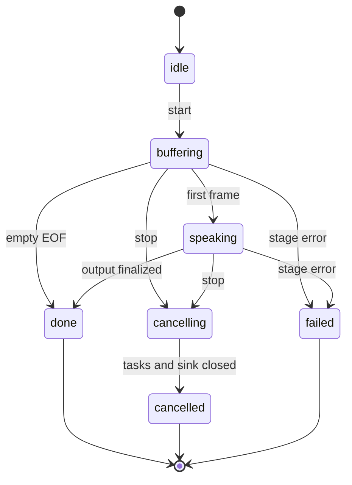

# Architecture and invariants

Audri owns text-to-audio orchestration and delivery. A model backend owns model
loading and inference. The Fish backend crosses a process/network boundary;
the Qwen backend owns one local native worker. These boundaries keep model
environments separate and make lifecycle behavior testable without checkpoints.

## Audio contract

`AudioFrame` contains immutable PCM bytes and `AudioFormat`. PCM is signed
16-bit little-endian, interleaved by channel. `samples` counts instants per
channel, so `duration_s = samples / sample_rate`; channels do not multiply
duration. Empty frames and partial interleaved samples are rejected.

No implicit resampling occurs. Fish's actual WAV header determines its format.
Qwen's returned rate determines its format. A sink and session reject format
changes within one stream. Applications that combine different model rates must
perform an explicit conversion before mixing or concatenation.

`PCMFramer` adapts arbitrary byte boundaries into approximately 20 ms frames.
It preserves a final short frame without zero padding. An incomplete sample at
EOF is corruption and raises an error.

## Request contract

`SynthesisRequest` is immutable and validates numeric controls, reference sizes,
and reference selection. Empty text is useful as a session template; a backend
emits no frames for it. `VoiceReference` stores encoded audio bytes and a
transcript, never an untrusted remote path. References are not persisted by
Audri. Applications control their retention and upstream cache policy.

Fish's `language` field is framework metadata because its native request
schema does not accept a language argument. Fish model selection occurs at
server startup. Qwen supports language selection and model-specific voice
controls. Unsupported combinations fail rather than silently changing voices.

## Session ownership

Each `SpeechSession` has one input queue, one chunk owner, one text queue, one
driver-stream task, one audio queue, one sink, and one cancellation token.
`TaskGroup` supervises the stages. EOF is ordered with text; the final flush
obeys the same chunk bounds as incremental commits.

Input limits bound individual delta size and accepted conversation text. Queue
capacities bound buffered work. Output limits bound frame size and cumulative
audio duration. A chunk's synthesis deadline also includes time waiting on
downstream queue capacity; a permanently stalled consumer cannot retain an
active utterance indefinitely.

On failure, sibling stages are cancelled, the driver iterator is closed, and
the sink aborts. The original error is visible through `wait`/`finish` and
`SpeakTool.end`; it is not converted into a successful empty result. A backend
that unexpectedly raises `CancelledError` also terminates its siblings.

`stop` discards queued audio and waits for sink abort before returning. A
replacement session with the same identifier has a separate generation; the
old generation's cleanup cannot remove the new one. Independent sessions never
share a cancellation flag.

The application must call `end` or `stop`, or close its `SpeakTool`. Use an async
context manager so a failed text producer also releases the audio session.
`close_driver=False` is for nested managers whose backend has another owner.

## Model worker ownership

Fish request concurrency is bounded by a semaphore. Each transport has its own
producer and a two-frame queue. A request cancellation watcher closes the
response even when the consumer is paused. The client is reused for connection
pooling and closed by the owner. Synthesis requests are never automatically
retried after partial audio: replay would duplicate what a listener heard.

Local Qwen inference is synchronous and returns a whole waveform. One executor
worker and lock own the model. Cancelling an awaiting coroutine discards its
result, but the lock is held until native computation actually returns. New
requests therefore cannot race the model or clear another request's stop flag.
Shutdown waits for outstanding model work; process isolation is required for a
hard kill of a stuck GPU call.

## Sink ownership

`write(frame)` is the backpressure boundary. `close()` means successful EOF;
`abort()` means discard buffered output. The queue sink signals termination out
of band, so it does not require a spare queue slot to shut down. Callback sinks
await async callbacks; synchronous callbacks should be short.

The WAV sink writes a temporary file alongside the destination and only
publishes after finalizing the header. Abort removes the partial file. Existing
destinations are protected by atomic no-replace publication unless overwrite
was explicitly requested. Local playback lazily opens a device and aborts its
buffer on interruption; its hardware behavior still requires device testing.

## Transport ownership

HTTP WAV output is staged to temporary disk to provide a valid finite RIFF
container. PCM output streams immediately and includes format headers. A
backend error before the first frame produces an HTTP error. Once response
headers and PCM have been sent, a later failure terminates the response; it
cannot retroactively replace HTTP 200. Use WebSocket terminal events when the
application needs an explicit completion/error signal.

WebSocket reception remains active while an input feeder awaits queue capacity
or EOF draining. A send lock orders format, PCM, and terminal messages. Stop
waits for the old generation before acknowledging; clients can treat `stopped`
as a delivery boundary. Input overflow is reported and stops the session.

Admission slots span the complete request or WebSocket connection. Disconnect,
send timeout, input timeout, backend failure, and normal completion release
resources. Optional authentication is separate for Audri and the model service.

## Scope of measurements

`first_audio_ms` in a session measures session start to first generated frame,
including waiting for sufficient text. Emitted audio duration is counted only
after the sink accepts a frame. Generator wait time excludes downstream queue
waits but can include transport, backend admission, and inference. CLI benchmark
RTF includes the whole client request. These metrics answer different operational
questions; neither alone establishes audio quality or GPU utilization.

The model-server deployment remains an explicit validation boundary. Protocol
fixtures and diagnostic tones verify software contracts; listening tests and
GPU load tests establish actual speech quality and service capacity.
